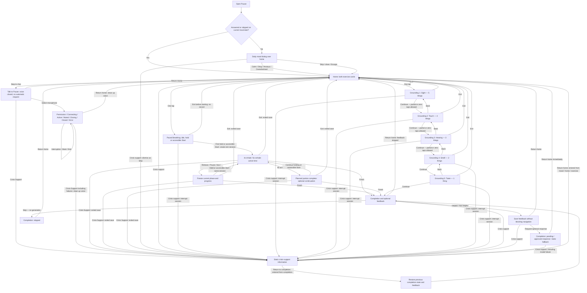

# Current user flow — interactive skills

The original screen types plus direct AI conversation are shown; five Grounding states belong to one screen type. Crisis information is an independently accessible auxiliary route. Saved-history review is reserved for Part 3.3 and is not in this diagram. See [design](design.md) for exact behavior and [research decisions](research-decisions.md) for rationale.

Feedback and response nodes are states of the same completion screen, not additional screens. Restoring completion preserves selected feedback and approved text; it does not automatically issue another model request. A saved return-state token determines the crisis route's return destination.

Every exercise Exit is immediate and records exited status if persistence is available. Crisis access records an active exercise as exited and never resumes it automatically. Opening crisis information from the mood dialog records a daily Skip. Crisis resources remain visible if any save/model request fails; no arrow waits for an AI response or successful database write. Daily dismissal uses browser-local date state first and SQLite later. Model failures use neutral static UI copy while home and crisis buttons stay enabled; they do not create a model-reply record. Feedback/model nodes describe the visible state, not guaranteed database persistence. A failed save is shown as unsaved; no arrow waits on a successful write. Stable card order remains default; any optional ordering changes neither available exercise nor navigation. Breathing has no automatic completion:60 active seconds triggers a planned-complete notice, while Finish records completed and Exit records exited. Opening/ready Exit creates no record.

Grounding circles toggle noticed/unnoticed; Back retains all in-exercise taps and Continue never requires them. Fifth Continue completes; no step advances automatically.70-second intended pace, actual duration/setup saved separately, no90-second forced deadline. Historical STOP is absent from selection but saved rows remain; the [original flow](history/part-3-1-user-flow.md) is preserved.

Conversation is optional and never gates exercise access. The assistant may suggest a supported exercise conversationally, but the user returns Home and selects it manually. No AI navigation tool or focus questionnaire exists. Voice starts only after microphone selection, remains transient and ends through existing cleanup on departure. The existing post-exercise text feedback remains; there is no typed-chat composer in this increment. Historical recommendation records remain readable, while the old creation route is removed.

Breathing release/cancel/focus loss pauses active time without resetting progress or duplicating the session. Hidden-page pauses; page departure attempts an exited save. Finish may be early or after optional continuation. Planned60s, active, optional continuation, total wall time and setup are distinct; none measures actual respiration. Native Start/Pause and reduced motion remain available; all navigation remains independent of saving.
