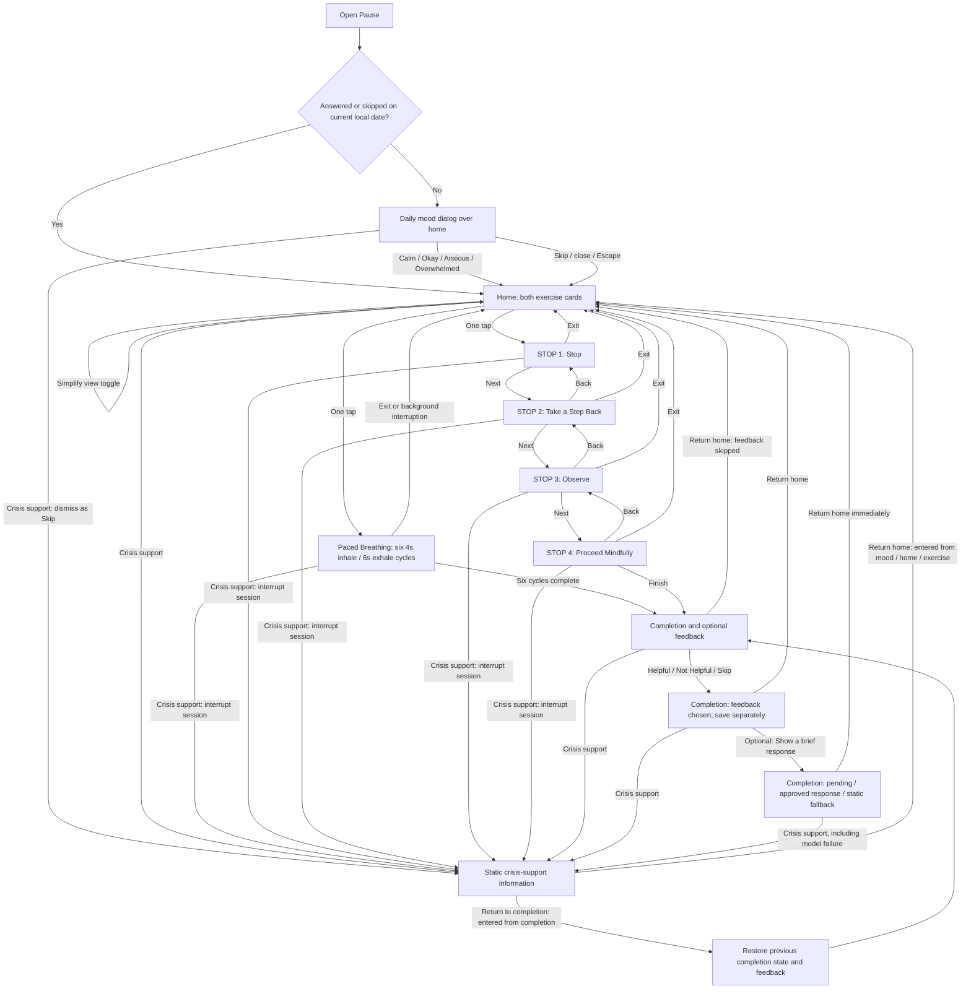

# Initial user flow

Five screen types are shown; four STOP states belong to one screen type. Crisis information is an independently accessible auxiliary route. Saved-history review is reserved for Part 3.3 and is not in this diagram. See [design](design.md) for exact behavior and [research decisions](research-decisions.md) for rationale.

Feedback and response nodes are states of the same completion screen, not additional screens. Restoring completion preserves selected feedback and approved text; it does not automatically issue another model request. A saved return-state token determines the crisis route's return destination.

Every exercise Exit is immediate and records exited status if persistence is available. Crisis access marks an active exercise interrupted and never resumes it automatically. Opening crisis information from the mood dialog records a daily Skip. Crisis resources remain visible if any save/model request fails; no arrow waits for an AI response or successful database write. Daily dismissal uses browser-local date state first and SQLite later. Model failures use neutral static UI copy while home and crisis buttons stay enabled; they do not create a model-reply record. Feedback/model nodes describe the visible state, not guaranteed database persistence. A failed save is shown as unsaved; no arrow waits on a successful write. Stable card order remains default; any optional ordering changes neither available exercise nor navigation. Automatic breathing completion ends the planned sequence, not permission to remain or leave; Return home remains voluntary.
